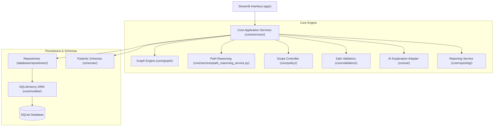

# Technical Architecture — ChainBreak

## 1. System Architecture

## 2. Layer Boundaries & Isolation
- **Interface Layer (`app/`):** Streamlit UI. Calls service functions exclusively; contains no database transactions, graph algorithms, or policy evaluation.
- **Service Layer (`core/services/`):** Orchestrates business use cases (lab management, path discovery, validation, reporting).
- **Graph Layer (`core/graph/`):** Constructs NetworkX directed graphs from persisted records, finds simple paths, extracts subgraphs, and serializes graph representations.
- **Policy Layer (`core/policy/`):** Central server-side scope enforcement engine. Evaluates lab scope allowlists and fails closed on any ambiguous condition.
- **Validation Layer (`core/validators/`):** Isolated read-only validators that execute only after scope approval.
- **AI Layer (`core/ai/`):** Optional LLM integration with an offline deterministic fallback that guarantees zero failure when no API key is supplied.
- **Persistence Layer (`database/`):** SQLAlchemy ORM models, session management, and CRUD repositories.

## 3. Path Generation Rules
A candidate risk path in ChainBreak must satisfy:
1. **Start Point:** An asset node within the laboratory.
2. **Termination:** An asset node or a finding node.
3. **Minimum Length:** At least 2 edge hops (sequence of ≥ 3 nodes).
4. **Weakness Association:** Traverses or links directly to one or more finding nodes.
5. **Cycle Prevention:** Simple path traversal (`nx.all_simple_paths`) prevents infinite loops.
6. **Bounded Execution:** Bounded by `MAX_PATH_LENGTH` (default 6) and `MAX_CANDIDATE_PATHS` (default 50).

## 4. Status Transition Lifecycle
- **Path Status:**
  `candidate` ➔ `under_review` ➔ `partially_supported` ➔ `supported` / `inconclusive` / `blocked` / `closed`.
- **Validation Result:**
  `not_run` ➔ `confirmed` / `not_confirmed` / `inconclusive` / `blocked`.
