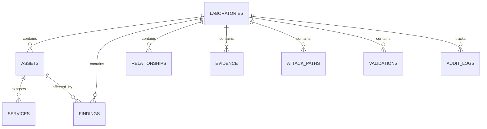

# Database Schema Documentation — ChainBreak

ChainBreak persists relational and graph records in an embedded SQLite database using SQLAlchemy ORM.

## Tables & Relationships

### 1. `laboratories`
- `id` (VARCHAR(36), PK): UUID or unique identifier.
- `name` (VARCHAR(255), UNIQUE): Lab name.
- `description` (TEXT): Overview and purpose.
- `scope_policy_json` (TEXT): JSON containing `allowed_asset_ids`, `allowed_validation_categories`, `prohibited_actions`, and `validation_enabled`.
- `created_at`, `updated_at` (DATETIME).

### 2. `assets`
- `id` (VARCHAR(36), PK): Asset ID.
- `lab_id` (VARCHAR(36), FK -> `laboratories.id` ON DELETE CASCADE).
- `name` (VARCHAR(255)): Host or machine label.
- `hostname` (VARCHAR(255)): FQDN or hostname.
- `ip_address` (VARCHAR(45)): IP address.
- `asset_type` (VARCHAR(50)): e.g., `server`, `database`, `workstation`.
- `operating_system`, `os_version` (VARCHAR).
- `description`, `metadata_json` (TEXT).

### 3. `services`
- `id` (VARCHAR(36), PK): Service identifier.
- `asset_id` (VARCHAR(36), FK -> `assets.id` ON DELETE CASCADE).
- `name` (VARCHAR(255)): Service name (e.g. `HTTP`, `MySQL`).
- `protocol` (VARCHAR(50)): `TCP`, `UDP`.
- `port` (INTEGER): Port number.
- `version` (VARCHAR(100)): Version string.
- `evidence_id` (VARCHAR(36)): Reference to evidence record.

### 4. `findings`
- `id` (VARCHAR(36), PK): Finding ID.
- `lab_id` (VARCHAR(36), FK -> `laboratories.id` ON DELETE CASCADE).
- `asset_id` (VARCHAR(36), FK -> `assets.id` ON DELETE CASCADE).
- `title` (VARCHAR(500)): Finding title.
- `description`, `remediation` (TEXT).
- `category` (VARCHAR(100)): Weakness category.
- `severity` (VARCHAR(20)): `critical`, `high`, `medium`, `low`, `informational`, `unknown`.
- `evidence_ids_json` (TEXT): JSON list of associated evidence IDs.
- `status` (VARCHAR(50)): `open`, `confirmed`, `remediated`.

### 5. `relationships`
- `id` (VARCHAR(36), PK): Edge identifier.
- `lab_id` (VARCHAR(36), FK -> `laboratories.id` ON DELETE CASCADE).
- `source_node_id`, `target_node_id` (VARCHAR(36), INDEXED).
- `relationship_type` (VARCHAR(50)): `connects_to`, `hosts`, `affected_by`, `has_permission`, etc.
- `evidence_status` (VARCHAR(20)): `observed`, `inferred`, `verified`, `missing`, `contradicted`.
- `evidence_ids_json` (TEXT): JSON list of evidence record IDs.

### 6. `evidence`
- `id` (VARCHAR(36), PK): Evidence ID.
- `lab_id` (VARCHAR(36), FK -> `laboratories.id` ON DELETE CASCADE).
- `evidence_type` (VARCHAR(100)): `service_scan`, `configuration_check`, `network_topology`, etc.
- `source` (VARCHAR(500)): Filename or source identifier.
- `description` (TEXT).
- `content_json` (TEXT): Serialized payload.
- `content_hash` (VARCHAR(64)): SHA-256 hash.

### 7. `attack_paths`
- `id` (VARCHAR(36), PK): Path ID.
- `lab_id` (VARCHAR(36), FK -> `laboratories.id` ON DELETE CASCADE).
- `title`, `description` (TEXT).
- `path_status` (VARCHAR(30)): `candidate`, `under_review`, `partially_supported`, `supported`, `inconclusive`, `blocked`, `closed`.
- `rationale`, `confidence_rationale` (TEXT).
- `path_data_json` (TEXT): Structured graph sequence data.

### 8. `validations`
- `id` (VARCHAR(36), PK): Validation record ID.
- `lab_id`, `asset_id`, `finding_id` (VARCHAR(36)).
- `validation_category` (VARCHAR(50)).
- `requested_action` (VARCHAR(255)).
- `scope_decision` (VARCHAR(20)): `allowed`, `blocked`.
- `result` (VARCHAR(20)): `confirmed`, `not_confirmed`, `inconclusive`, `blocked`, `not_run`.
- `reason` (TEXT).
- `validator_module` (VARCHAR(255)).

### 9. `audit_logs`
- `id` (VARCHAR(36), PK): Event identifier.
- `lab_id` (VARCHAR(36)).
- `event_type` (VARCHAR(50)).
- `target_type`, `target_id` (VARCHAR).
- `decision`, `reason` (TEXT).
- `metadata_json` (TEXT).
